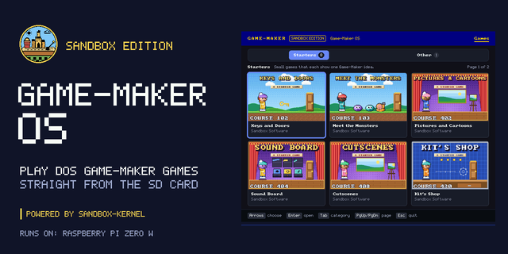
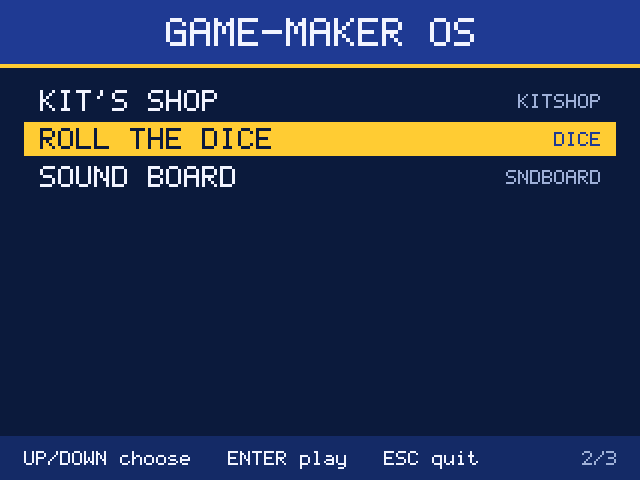
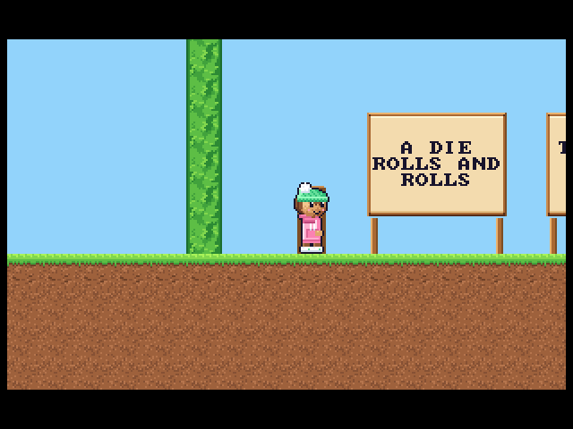

# Game-Maker OS

Game-Maker OS turns a Raspberry Pi into a Game-Maker machine. It boots straight to a list of games you can play on a TV with a gamepad or remote. It is the Sandbox Edition of RSD Game-Maker 3.0, running as an operating system of its own.

It runs on [sandbox-kernel](https://github.com/lewismoten/sandbox-kernel), a small MIT-licensed bare-metal kernel for Raspberry Pi. The kernel owns the hardware and exposes it through a standard, POSIX-style interface. Game-Maker OS is a separate program the kernel loads from the SD card. If the OS fails, the kernel recovers instead of leaving a blank screen.

## Status

The first program runs on the board and plays games. `GMOS.ELF` lists the games in `/sd/GAMES` (each a folder with a `.GAM` file, or one packed `.GMP` file there or in `/sd/POCKET`, the same file the Pocket Player plays; see [docs/gmp.md](docs/gmp.md)) and shows them on HDMI at 960x540 (16 bits a pixel, which the GPU doubles to fill a 1080p screen) the way the Sandbox Edition web site's Games page does: category tabs, cards with each game's title screen read from its own files, and a details view with the blurb and Play. A library index on the card (`LIBRARY.JSL`, the Pocket Player's `library.jsonl` format, written by the Sandbox Edition's `web/scripts/gmosCard.ts`) gives the titles, categories and blurbs. Play opens the chosen game’s title slides and DOS main menu (Up/Down, Enter; Esc or Quit returns to the library). Its Play choice starts the levels from their original DOS files: the pages between scenes as PLAYGAME shows them (GIF pictures and BKD backdrops fading in, FLI animations frame by frame, text pages in PLAYGAME's font, lists of them), then the levels at PLAYGAME's 18.2 ticks a second, doubled on a 640x480 screen, fading in and out. Games saved before Game-Maker 3.00 play too. The arrow keys, Space and Enter play. Back/Esc during play opens a pause menu with Resume, Save game, Load game and Leave game. Leaving or finishing checks the Top Ten; a qualifying name uses the same on-screen keyboard as Search, then returns to the game’s menu. Instructions, storyline, credits and scores also return to that menu. On a Pi Zero W, Roll the Dice and five more Starters draw the same frames as the host tests, tick for tick. This branch links local CMF/OPL2 music, PC-speaker effects and supported VOC clips through the kernel ABI 1.8 `/dev/audio`, with silent fallback when unavailable. Library music defaults off; the Details **Music** button or **M** toggles it. Game/demo sound follows the game independently; HDMI playback remains **hardware-untested**. Games also log `SND` events for remote playback (`docs/play.md`, Sound events). The native GMOS menus and text entry work with HDMI-CEC arrows, OK and Back, or a keyboard. Remote hardware behavior still needs a board test; development key injection over USB remains available.

The screen shows the castle badge splash (`docs/boot-art.md`) from the moment `/dev/fb0` is open until the list is ready, and a library diagnostics screen when the library is empty.

The Games page also has **Search**, **Favorites** and **Recent** tabs. Search opens an arrow/OK on-screen keyboard. Details exposes **Play**, **Back**, **Favorite**, **High scores** and **Music** buttons. Back/Esc stays in the top-level library; only keyboard **Q** quits GMOS. Search filters titles and companies live; **F** or the Details **Favorite** button toggles a yellow star. Recent keeps the last 20 games started. Up from the top row focuses tabs, then Left/Right and Enter choose one. Favorites and Recent persist under `/OS/SAVES/GMOS/`. The **/** + exact folder + Enter development command still works. See [library controls and storage](docs/library.md).

Leave a game on its details view for 3 seconds and its demo plays in the picture (any key stops it; see [docs/demo.md](docs/demo.md)). On ABI 1.11+ kernels, gameplay, demos and timed cartoons/slides keep the TV awake and the ARM clock at full speed; menus and pages waiting for a key permit power saving. See [idle power behavior and Pi checks](docs/power.md).

The game player shares the play core with [Game-Maker Pocket](https://github.com/lewismoten/gamemaker-pocket), the Pocket Player in Game-Maker: Sandbox Edition: `third_party/gmcore` is a copy pinned by commit (see [docs/play.md](docs/play.md)).

The first target is a Raspberry Pi Zero W v1.1 with a Waveshare 2.13 inch e-Paper HAT (V4) as a status display, connected to a computer by USB for development. Optional [e-ink status](docs/build.md#optional-e-ink-status-abi-19) is linked into `GMOS.ELF`: a loading page, library count, game title and F5 `SAVING` status (ABI 1.9+; **hardware-untested**).

Press H on the grid or details view for [Top Ten](docs/saves.md). During a level, Back/Esc opens the pause menu to Save/Load; F5/F6 still open those screens directly, with ten named slots and an on-screen name keyboard under `/OS/SAVES`; see [save/load controls and limits](docs/game-save.md). Saving needs ABI 1.7+. High scores and live save/load are linked; real-card writes and DOS runtime interchange remain **hardware-untested**.

To jump straight to a game's card over USB, use
`python3 tools/open_game.py /dev/cu.usbmodemXXXX DICE` (`--play` also presses
Play). See [open by folder name](docs/build.md#open-a-game-by-folder-name-over-usb).

## A JavaScript layer (spike)

`JS.ELF` runs a small web-page-like app from the card: JavaScript (QuickJS-ng) with `document.createElement`, CSS-like styles, events, `requestAnimationFrame` and a `<game>` element that plays a game with the same play core, while the layout and drawing stay native. See [docs/js.md](docs/js.md) for how to make your own shell with it. The numbers are in sandbox-kernel's `docs/js-spike.md`.

## Build

Desktop card copying now supports long-named loose game folders, stored/deflated
ZIP games and plain-ZIP self-extracting EXEs (read as archives, never executed),
alongside GMP packs. Kernel ABI 1.5+ is required for long names; the vendored SDK is ABI 1.11.
See [copying games and verification limits](docs/drag-drop.md). This candidate
is host-qualified; its new FAT-card/Pi workflow is **hardware-untested**.

`GMOS.ELF` is built only against the sandbox-kernel SDK, vendored in `sdk/` at the kernel commit named in `sdk/PINNED`, and the shared play core in `third_party/gmcore` (commit in its `PINNED`). `make` builds it with the Arm GNU toolchain; `make test` builds the host tools and `GMOS.ELF`, checks the 8 MiB image quota with 64 KiB headroom, runs the host tests and renders PNG files in `build/host/`. `make js` builds the separate `build/JS.ELF`; it is not part of the default build. See [docs/build.md](docs/build.md) for installing it on a card and driving it over USB.

The [PC-speaker PCM producer](docs/pcspeaker-host.md) is linked into `GMOS.ELF`
and the host gameplay library. Local audio combines it with CMF/OPL2 music and
[streamed VOC clips](docs/voc.md); the separate [VOC host core](docs/voc-host.md)
remains a qualification component. `JS.ELF` retains remote `SND` events without
local audio. See [sound behavior and silent fallback](docs/build.md#sound-and-library-music).

## Plan

- Boot to a games list on HDMI; play with a USB gamepad, the TV remote (HDMI-CEC) or an IR remote.
- Games live in a `games` folder on the SD card that any computer can copy files into; Wi-Fi downloads come later.
- Qualify linked PC-speaker effects, VOC clips and CMF/OPL2 music on hardware.
- Keep sharing the play core with [Game-Maker Pocket](https://github.com/lewismoten/gamemaker-pocket).
- Later: more e-ink desk-buddy pages (games played and badges), a private game server for the home network, and other Pi models from the same SD card.

## License

MIT. See [LICENSE](LICENSE).
