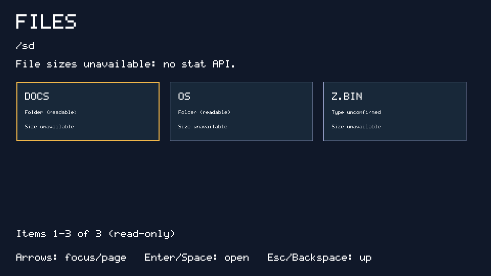
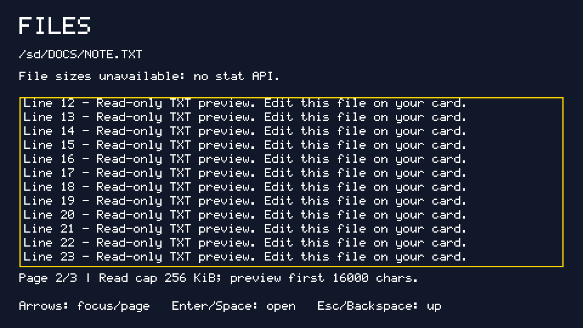

# FILES: a read-only card browser

A full-screen **960×540×16** grid of six cards at a time, built only with the
[documented JavaScript API](../../docs/js.md). Browse readable folders, move
focus with arrows, and open `.TXT` files in a paged text view. **Exact file sizes
are unavailable**, not zero: this API has no `stat` and returns names only.

## What it teaches

- Build reusable pixel-positioned elements with `createElement` and `style`.
- Read and sort `fs.readdir` names; probe readable folders without pretending
  that a failed probe proves an entry is an ordinary file.
- Handle expected read errors without crashing; never insert file contents as HTML.
- Keep a small folder history and restore focus after leaving a text view/folder.
- Prevent the native arrow default when implementing deterministic grid focus.
- Split, sanitize, wrap and page text because the bitmap renderer is single-line.
- Retain live node references explicitly and release old page arrays on rebuild.

`MAIN.JS` is the whole app. No packages, imports, assets or runtime edits needed.

## Launch

From the repository root:

```sh
make host
mkdir -p build/files-card/OS/APPS build/files-card/DOCS
ln -sfn "$PWD/apps/FILES" build/files-card/OS/APPS/FILES
printf 'Hello from the card!\nA second line.\n' > build/files-card/DOCS/NOTE.TXT
build/host/jsrun build/files-card /sd/OS/APPS/FILES --vclock --ms 800 \
  --keys 100:28:1,120:28:0,300:28:1,320:28:0 --shot build/files.shot
python3 tools/jsshot.py build/files.shot build/files.png
```

The example presses Enter twice: open the alphabetically first root card DOCS,
then its NOTE.TXT. Open the PNG; jsrun has no visible window. If Linux linking
fails with `cannot find -lc++`, use the build-only GCC adapter in the
[CLOCK guide](../CLOCK/README.md#run-on-linux). The unmodified build did fail
that way on the tested machine; the adapter build succeeded without C edits.

On a board, install JS.ELF using [docs/js.md](../../docs/js.md), copy this folder
to `/OS/APPS/FILES`, then set `/OS/AUTORUN.TXT` to:

```text
JS.ELF
APPS/FILES
```

960×540×16 support is required; the app does not silently claim success in a
smaller mode. Board video/keyboard execution has not been tested.

## Controls and behavior

| Key | Folder grid | TXT view |
| --- | --- | --- |
| Left / Right | Previous / next sorted entry | Previous / next text page |
| Up / Down | Move three entries; clamp at ends | Previous / next text page |
| Enter / Space | Open focused entry | No action |
| Esc / Backspace | Parent folder; root stays at `/sd` | Return to folder, restore focus |

The selected entry determines which six-card page is visible. Held arrow keys
can repeat; a held Back key does not repeatedly climb directories. Empty
folders show an explicit message and can be left with Esc. Entries are sorted
by name, not by an invented directory metadata field. A successful `readdir`
probe labels a card **Folder (readable)**. All other types remain unconfirmed;
a `.TXT` suffix offers a preview, not a guarantee about the entry's contents.

TXT previews normalize CRLF/CR to newline, replace each tab with four spaces,
replace non-ASCII/control characters with `?`, and hard-wrap at **72 characters**
into **12 rows per page**. This fits the 18px bitmap font without browser wrapping.
File content is assigned through `textContent`, never `innerHTML`. Other file
types get a message instead of a misleading text/binary preview.

## Real screenshots and reproduction

```sh
python3 tools/js_example_shots.py
# Dumps, logs and PNGs: build/example-shots/FILES/
```

The script creates and removes its own fixture card. It has DOCS/NOTE.TXT
(30 numbered ASCII lines), OS/APPS containing all three examples, and Z.BIN.
Every capture is a **fresh** app run, `--vclock --ms 800`, converted with
`tools/jsshot.py` at scale 1. Linux key codes: Enter 28, Right 106, Escape 1.

| Screenshot | `--keys` | Expected endpoint |
| --- | --- | --- |
| [Root](screenshots/root.png) | omitted | DOCS focused, exact sizes explicitly unavailable |
| [Folder](screenshots/folder.png) | `100:28:1,120:28:0` | `/sd/DOCS`, NOTE.TXT focused |
| [TXT](screenshots/text.png) | `100:28:1,120:28:0,300:28:1,320:28:0` | Page 1/3, lines 00–11 |
| [TXT page two](screenshots/text-page2.png) | `100:28:1,120:28:0,300:28:1,320:28:0,500:106:1,520:106:0` | Page 2/3, lines 12–23 |
| [Root restored](screenshots/root-restored.png) | `100:28:1,120:28:0,300:28:1,320:28:0,500:1:1,520:1:0,650:1:1,670:1:0` | Original root and focus restored |





Root and restored-root framebuffer dumps match byte-for-byte. Visual inspection
checked the card focus, folder view, both TXT pages, readable gap notice and
controls. These are real host captures, not mock layouts.

## Tests

```sh
python3 -m unittest discover -s tests -p test_js.py -v
```

`Files` runs the actual app through `build/host/jsrun` with scheduled keyboard
events and test-only DOM observers. It checks exactly **120 animation callbacks**
(no frame-count flag is invented), navigation, text paging/back, crossing grid
pages, empty folders, root boundary, non-TXT/read errors, long paths, ASCII
conversion and a **300,000-character** input larger than the runtime read cap.
The large-input test also checks that all 17 text nodes remain after collection.
All app checks reject exceptions in logs even if the runner exits zero.
See the [suite summary](../README.md) for regression results and limits.

## Customize

Change the colors and `box` coordinates to build a different shell. Change the
starting `folder` only to an existing `/sd/...` path; adapt the root/back policy
if starting elsewhere. Adjust `CARDS`, columns, movement, wrapping width and
`ROWS` together when changing geometry; keep text within its pixel box. Add
other read-only text suffixes in `openEntry` if desired. Do not replace unavailable
sizes with string lengths or promise saving with this runtime.

## API gaps and deliberate limits

- **No stat/size/type metadata:** names only; readable-directory probes are not
  stat, can cost I/O, and cannot distinguish inaccessible folders from files.
  No fabricated file sizes. Sorting and history use an in-memory listing snapshot;
  changing/removing media while the app is running is not a live-refresh feature.
- **Read cap:** `fs.readFile` returns a decoded string from at most **256 KiB**,
  without offset reads, byte length or a truncation indicator. The UI always warns
  about this cap and only previews the first **16,000 decoded characters** before
  formatting. It never claims to know whether the underlying file is complete.
- **Path buffer:** open only ASCII paths of at most 95 bytes to avoid native
  truncation. Reject `.`/`..` and names containing separators. Display names and
  path labels are ellipsized; original names remain the lookup keys. Unicode
  paths are not opened. Host filesystem symlinks are a trusted fixture convenience,
  not a security sandbox or a permission boundary provided by this app.
- **Text/UI:** no Unicode font, native multiline widget, scrolling, mouse or touch.
  The app keeps only one page of DOM nodes, but `readdir` itself returns the whole
  directory and large directories can still exhaust the 3 MiB JS heap.
- **Node lifetime:** this runtime spike can collect attached labels that have no
  explicit JS reference under heap pressure. `rootNodes` and `pageNodes` retain
  live nodes; page rebuilds release old references. Regression tested without
  changing the C runtime. Broader runtime ownership repair is separate work.
- No write/delete/rename support. This is a read-only example, not a full file manager.
