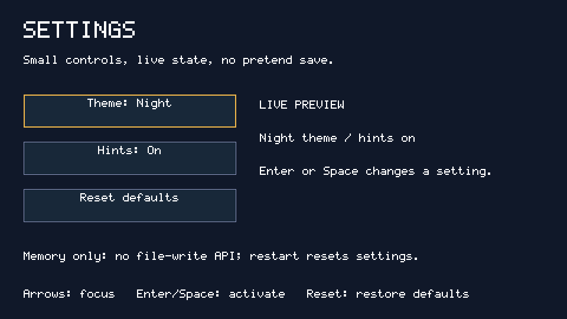
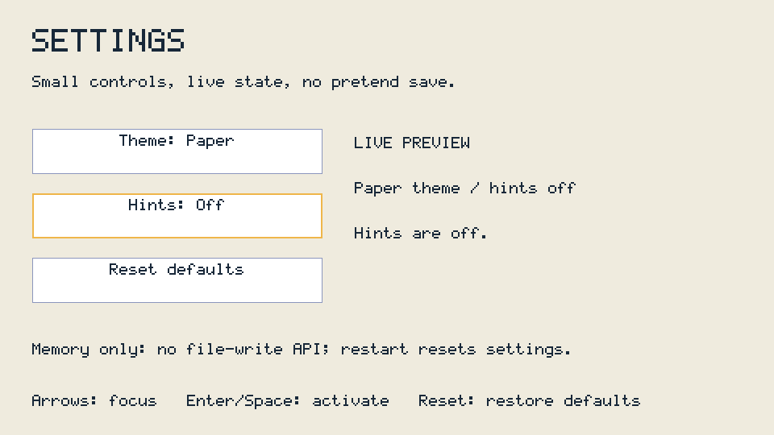
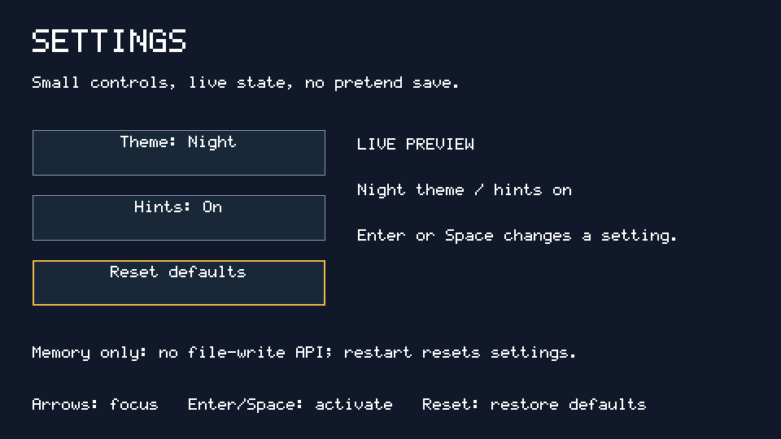

# SETTINGS: buttons, toggles and live state

A **960×540×16** settings page using the [documented JS API](../../docs/js.md).
Theme and Hints are ordinary buttons backed by a small JavaScript state object.
Reset restores defaults. Changes are visible immediately and **kept only in
memory**: the runtime has no file-write API, so there is no pretend Save button.

## What it teaches

- Build and style `text` and `button` elements without browser form controls.
- Use the runtime's native arrow focus and Enter/Space click behavior.
- Keep state separate from rendering: each click updates state, then `render()`
  changes labels, preview text, background and button colors.
- Reset from a defaults object instead of duplicating initial values in handlers.
- Tell users what is unsupported, rather than claiming a setting was saved.
- Keep explicit JS references to labels for this spike's node-lifetime limitation.

`MAIN.JS` is the whole app. No HTML, packages or new runtime APIs required.

## Launch

From the repository root:

```sh
make host
mkdir -p build/settings-card/OS/APPS
ln -sfn "$PWD/apps/SETTINGS" build/settings-card/OS/APPS/SETTINGS
build/host/jsrun build/settings-card /sd/OS/APPS/SETTINGS --vclock --ms 800 \
  --keys 100:28:1,120:28:0,200:108:1,220:108:0,300:57:1,320:57:0 \
  --shot build/settings.shot
python3 tools/jsshot.py build/settings.shot build/settings.png
```

This selects Paper with Enter, moves down to Hints and turns them off with Space.
Open the PNG; the host runner is headless. On Linux without libc++, the current
Makefile's `-lc++` link fails; the build-only GCC adapter in the
[CLOCK guide](../CLOCK/README.md#run-on-linux) is the tested workaround, with no
Makefile/C-runtime modifications.

For the board, install JS.ELF using [docs/js.md](../../docs/js.md), copy this
folder to `/OS/APPS/SETTINGS`, then set `/OS/AUTORUN.TXT` to:

```text
JS.ELF
APPS/SETTINGS
```

The requested 960×540×16 mode must be supported. There is no smaller-mode fallback
claim and physical board/video/keyboard behavior remains untested.

## Controls and supported behavior

| Control | Action |
| --- | --- |
| Up / Down arrows | Native spatial focus among the three vertically stacked buttons |
| Enter / Space | Activate focused button; key-repeat does not repeat a native click |
| Theme button | Night ↔ Paper; updates all page and button colors |
| Hints button | On ↔ Off; updates the live preview and explanatory hint |
| Reset defaults button | Night + Hints On; focus stays on Reset |

The Theme button starts focused. There are no mouse/touch controls. Hints Off
changes the demonstration hint text; permanent navigation instructions and the
memory-only notice stay visible. Theme and hints apply to **this app**, not to
other apps or the native OS. Closing/restarting starts again with defaults.

## Real screenshots and exact sequences

```sh
python3 tools/js_example_shots.py
# Dumps, logs and PNGs: build/example-shots/SETTINGS/
```

Each capture is a fresh `--vclock --ms 800` run. The script converts actual jsrun
dumps through `tools/jsshot.py`. Key codes: Enter=28, Down=108, Space=57.

| Screenshot | `--keys` | Expected endpoint |
| --- | --- | --- |
| [Defaults](screenshots/defaults.png) | omitted | Night, Hints On, Theme focused |
| [Changed](screenshots/changed.png) | `100:28:1,120:28:0,200:108:1,220:108:0,300:57:1,320:57:0` | Paper, Hints Off, Hints focused |
| [Reset](screenshots/reset.png) | `100:28:1,120:28:0,200:108:1,220:108:0,300:57:1,320:57:0,400:108:1,420:108:0,500:28:1,520:28:0` | Night, Hints On, Reset focused |







Visual inspection checked both palettes, updated labels/preview, focused-button
outlines and the always-visible persistence gap. Reset restores values, not the
initial focus, so its complete dump is intentionally not identical to Defaults.

## Tests

```sh
python3 -m unittest discover -s tests -p test_js.py -v
```

`Settings` executes the actual app and tests **exactly 120 animation callbacks**
with an appended test-only observer, initial state, memory-only notice, native
arrow navigation, Enter/Space toggles, ignored activation repeats and reset.
A separate injected allocation/read-pressure check verifies that all ten root
nodes including the gap notice survive collection. The app itself never reads
or writes files. Exceptions in logs fail tests even when exit status is zero.
See the [suite summary](../README.md) for combined regression evidence.

## Customize

Add fields to `defaults`, make another button, attach its click handler, and
render the field in `render()`. Edit the two palettes or the fixed pixel boxes.
Use font sizes 9, 18, 27 or 36 and short single-line labels; there is no CSS
stylesheet or automatic wrapping. Keep new labels in `nodes` so they survive
collection on this runtime. If a real write API is added later, design error
handling and load/save validation then; do not silently invent persistence now.

## API gaps

- **Persistence:** no `fs.writeFile`, rename, mkdir, localStorage or other public
  write API. Settings reset on app restart; no card bytes are changed or saved.
- **Controls:** no checkbox/radio/input form elements, general CSS, Unicode font,
  mouse or touch. Buttons provide clear toggle labels and visible focus instead.
- **Node lifetime:** this runtime spike can collect attached-only labels under
  allocation pressure. Explicit live-node references avoid that symptom here;
  the test checks it without C-runtime changes. General ownership repair is
  separate work, not a claim that the runtime has been fixed.
- These are local demo preferences, not OS-wide settings. Hardware testing remains open.
